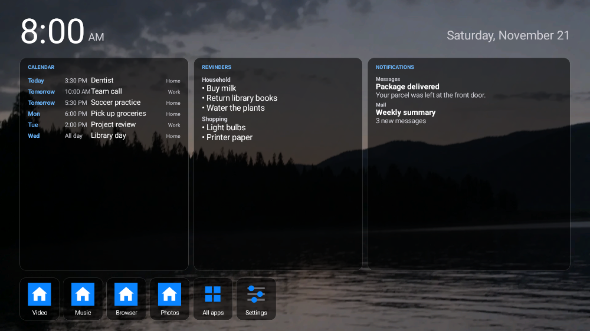

# firetv-home

firetv-home is a lightweight, ad-free home screen for Fire TV and Android TV. It shows a clock, a day-by-day calendar of one or more sources, birthdays, reminders and a row of your apps. It is written in Kotlin with plain Android Views (no Compose, no Leanback, no AppCompat) and runs on Fire OS 6 and later (Android API 25 and later).

Rendered off-device with Paparazzi from the app's real views and invented demo data (`ScreenshotTest`); the clock is pinned to the demo time. To regenerate it, run `./gradlew recordPaparazziDebug` and copy the PNG from `app/src/test/snapshots/images/`.

## Features

- Clock and date, following the system 12/24 hour setting.
- Two-column home: the calendar on the left, Birthdays above Reminders on the right.
- Calendar card: today plus the next `days` days (default 8), grouped by day with headers "Today", "Tomorrow" and "Tue Nov 24". All-day events come first in each day. Titles never get an ellipsis: they wrap to two lines, a long title steps its font size down until it fits, and one that still does not fit wraps onto more lines. Rows that do not fit the card are dropped. Sources are merged, then filtered. Providers: any iCal (`.ics`) feed, including a Google Calendar "secret address", or a Home Assistant calendar entity. When more than one source is configured, each row shows the source label.
- Calendar filter: hide events by title with case-insensitive regular expressions (`exclude`), with `include_exceptions` to keep some of them.
- Birthdays card: upcoming birthdays within a window (default 30 days) from a pushed file, an iCal feed or a Home Assistant calendar. Hidden when not configured.
- Reminders card: incomplete items from Home Assistant todo lists, or from Apple Reminders through an optional macOS helper.
- One row of apps in the order you choose, an "All apps" grid and a Settings tile.
- Optional push refresh over `adb shell am broadcast`.
- Two backgrounds: a neutral default and an optional photo ("bali").

Tested on a Fire TV Stick 4K running Fire OS 6.

## Install

1. On the TV, enable ADB debugging (Fire TV: Settings > My Fire TV > Developer options) and note its IP address.
2. Connect from your computer:

        adb connect <tv-ip>:5555

3. Build the APK (see [Building](#building)) or download a release APK, then install it:

        adb install -r app/build/outputs/apk/release/app-release.apk

4. Copy `config.example.json` to `config.json`, edit it, and push it to the app's files directory:

        adb shell mkdir -p /sdcard/Android/data/app.firetvhome/files
        adb push config.json /sdcard/Android/data/app.firetvhome/files/config.json

5. Start it:

        adb shell am start -n app.firetvhome/.MainActivity

The config is read again on every refresh (on resume, on a push, and every 15 minutes), except `background`, which needs the app to be restarted.

## Configuration reference

`config.json` lives at `/sdcard/Android/data/app.firetvhome/files/config.json`. All keys are optional. A card is hidden when it has no source. Keep `config.json` out of version control (it is gitignored).

| Key | Type | Default | Meaning |
|---|---|---|---|
| `ha_url` | string | empty | Base URL of Home Assistant, for example `http://homeassistant.local:8123`. Needed by `ha_calendar` and `ha_todo` providers. |
| `ha_token` | string | empty | Home Assistant long-lived access token. |
| `calendars` | list | empty | Calendar providers, see below. When present, the old `calendar_entity` and `ics_url` keys are ignored. |
| `reminders` | list | empty | Reminder providers, see below. When present, the old `todo_entities` key is ignored. |
| `background` | string | `default` | `default` for the neutral image, `bali` for the optional photo. `theme` is accepted as an alias. Unknown values fall back to `default`. |
| `calendar` | object | none | Calendar window and filter: `{"exclude": [...], "include_exceptions": [...], "days": 8}`. The same keys also work at top level (`exclude`, `include_exceptions`, `calendar_days`); the object wins. |
| `calendar.days` | integer | `8` | Days shown, starting today. Clamped to 1-31. |
| `calendar.exclude` | list of strings | empty | Events whose title matches any entry are hidden. Each entry is a case-insensitive regular expression; an entry that is not a valid regex is matched as plain text. |
| `calendar.include_exceptions` | list of strings | empty | Events that match an `exclude` entry but also match one of these are kept. Same matching rules. |
| `strip_booking_codes` | boolean | `true` | Top level. Hides booking codes such as `conf ABC123`, `Conf: ABC123`, `confirmation ABC123` or `PNR ABC123` (5-8 uppercase letters or digits) from event and reminder titles on screen. Display only; the source is unchanged. |
| `birthdays` | object | none | Birthdays source, see below. The card is hidden when this is missing. |
| `app_order` | list of strings | a short built-in list | Package names for the app row. Missing apps are skipped. The first one gets focus. |
| `calendar_entity` | string | empty | Old flat key. Home Assistant calendar entity id. Same as one `ha_calendar` provider. |
| `ics_url` | string | empty | Old flat key. iCal feed URL. Used only when no `calendar_entity` is usable. Same as one `ics` provider. |
| `todo_entities` | list | empty | Old flat key. Entity ids or `{"entity", "label"}` objects. Same as one `ha_todo` provider. |

Birthday providers (`birthdays`):

| Field | Type | Meaning |
|---|---|---|
| `type` | string | `block`, `ics`, `ha` or `google`. |
| `url` | string | For `ics`: the feed URL. |
| `entity` | string | For `ha`: a Home Assistant calendar entity id. Needs `ha_url` and `ha_token`. |
| `days` | integer | Window in days from today. Default `30`, clamped to 1-366. |

Calendar providers (`calendars`):

| Field | Type | Meaning |
|---|---|---|
| `type` | string | `ics` or `ha_calendar`. |
| `url` | string | For `ics`: the feed URL. `file:///...` also works for local testing. |
| `entity` | string | For `ha_calendar`: the entity id, for example `calendar.example`. Needs `ha_url` and `ha_token`. |
| `label` | string | Optional name shown on each row when several calendars are configured. |

Reminder providers (`reminders`):

| Field | Type | Meaning |
|---|---|---|
| `type` | string | `ha_todo` or `apple_reminders`. |
| `entities` | list | For `ha_todo`: `{"entity": "todo.example_list", "label": "Household"}` objects. Needs `ha_url` and `ha_token`. |
| `url` | string | For `apple_reminders`: URL of the JSON file served by the companion helper. |
| `file` | string | For `apple_reminders`: path of the JSON file, absolute or relative to the app files directory. Used when `url` is empty. |

Example filter: hide anything titled "Drop-in care" unless the title also says "Parents night out".

    "calendar": {
      "exclude": ["drop-?in care"],
      "include_exceptions": ["parents'? night out"],
      "days": 8
    }

The filter runs once, after all calendar sources (and a pushed `blocks/calendar.json`) are merged, on the event title only.

If one calendar source fails (network, bad feed), the others are still shown. The ICS parser handles all-day and multi-day events, TZID, UTC and floating times, RRULE (DAILY, WEEKLY, MONTHLY, YEARLY with INTERVAL, COUNT, UNTIL, BYDAY such as `2TU` or `-1FR`, BYMONTHDAY, BYMONTH), EXDATE, RECURRENCE-ID overrides and STATUS:CANCELLED.

The app can read its own files directory as is. For other places on shared storage, grant `adb shell pm grant app.firetvhome android.permission.READ_EXTERNAL_STORAGE` first.

## Connecting a calendar

Google Calendar:

1. Open Google Calendar on the web, then Settings.
2. Pick the calendar under "Settings for my calendars", then "Integrate calendar".
3. Copy "Secret address in iCal format". Treat it like a password: anyone with the URL can read the calendar. If it leaks, use "Reset" next to it.
4. Add it to `config.json`:

        "calendars": [
          { "type": "ics", "url": "https://calendar.google.com/calendar/ical/<your-secret-id>/basic.ics", "label": "Home" }
        ]

Add one provider per calendar. Google updates iCal feeds with a delay of up to a few hours, so use push refresh or a Home Assistant calendar if you need fresher data.

Other iCal feeds (Outlook, Fastmail, Nextcloud, school or team feeds): use the feed's `.ics` URL the same way.

Home Assistant calendar: set `ha_url` and `ha_token`, then add `{ "type": "ha_calendar", "entity": "calendar.example", "label": "Shared" }`. Create the token in your Home Assistant profile under "Long-lived access tokens".

## Reminders

Home Assistant todo lists: set `ha_url` and `ha_token`, then

    "reminders": [
      { "type": "ha_todo", "entities": [ { "entity": "todo.example_list", "label": "Household" } ] }
    ]

Apple Reminders: the TV cannot read Reminders directly. The optional macOS helper in [`companion/apple-reminders-helper`](companion/apple-reminders-helper) reads the lists you name and writes a small JSON file, which a tiny HTTP server can expose. Then add

    "reminders": [
      { "type": "apple_reminders", "url": "http://<mac-host>:8765/reminders.json" }
    ]

File schema (version 1):

    {
      "updated": "2026-01-01T12:00:00Z",
      "lists": [
        { "name": "Household", "items": [ { "title": "Buy light bulbs", "due": "2026-01-02" }, { "title": "Sort the garage", "due": null } ] }
      ]
    }

`due` is `YYYY-MM-DD`, an ISO 8601 date-time, or `null`. Items with a due date are shown first. The helper's README covers install, the macOS Reminders permission, and launchd. You can also have the helper push Reminders items into a Home Assistant todo entity and use the `ha_todo` provider instead.

## Push refresh

The app refreshes on resume and every 15 minutes. To refresh sooner, send a broadcast from any host with adb access to the TV:

    adb -s <tv-ip>:5555 shell am broadcast -a app.firetvhome.REFRESH -n app.firetvhome/.RefreshReceiver --es block calendar --el ts "$(date +%s000)"

`block` is `calendar`, `reminders`, `trips`, `birthdays` or `all` (the default when omitted). `ts` is optional and only appears in the log. The receiver only accepts broadcasts from the adb shell or the system. If the app is not in front, the refresh is applied the next time it resumes. You can also drop a file `blocks/calendar.json` (schema `{"v":1,"generated_at_ms":...,"events":[{"id","title","start","end","all_day"}]}`) into the app files directory. When it is less than two hours old it is used instead of the configured calendar sources.

## Birthdays

Add a `birthdays` object to `config.json`. Birthdays within `days` days are listed soonest first, up to five, as "Today — Name", "Tomorrow — Name" or "Sat Nov 29 — Name".

Pushed file (`type` `block`): the app reads `blocks/birthdays.json` from its files directory. A generator of your choice writes it and sends a `birthdays` push (see Push refresh).

    "birthdays": { "type": "block", "days": 30 }

Schema:

    {
      "generated": "2026-01-01T00:00:00Z",
      "source": "my-script",
      "items": [
        { "date": "2026-01-09", "name": "Alex", "title": "Alex's Birthday" }
      ]
    }

`date` is the day of the next birthday (`YYYY-MM-DD`). The `name` is shown; when it is empty `title` is used. Items with a bad date or no name are skipped. Only the dates in the window are shown, so write each person's next occurrence.

iCal feed (`type` `ics`): a feed whose events are birthdays. The event title is shown as the name. Recurring yearly events are expanded.

    "birthdays": { "type": "ics", "url": "https://example.com/birthdays.ics", "days": 30 }

Home Assistant calendar (`type` `ha`): a calendar entity such as the one for birthdays, needs `ha_url` and `ha_token`.

    "birthdays": { "type": "ha", "entity": "calendar.birthdays", "days": 30 }

Google (`type` `google`): accepted so a config can name it, but not implemented. The app logs "unsupported" and the card shows no birthdays. Export the Google "Birthdays" calendar as an iCal feed or through Home Assistant and use `ics` or `ha` instead.

## Removed features

Older versions had a pre-event alert (an overlay and a notification before each timed event), a recent-notifications card with a notification listener, and a boot receiver that re-armed alarms. All of it is gone, together with the `SYSTEM_ALERT_WINDOW`, `RECEIVE_BOOT_COMPLETED`, exact alarm and `POST_NOTIFICATIONS` permissions, the `calendar_alert_minutes` key (now ignored) and the `DEBUG_ALERT` broadcast. The default APK has no notification listener and no boot receiver. If you granted the old listener, undo it with `adb shell settings delete secure enabled_notification_listeners` (if nothing else was in that setting). The experimental `-PswitchHome` build still declares `RECEIVE_BOOT_COMPLETED` for its own boot receiver.

## Setting it as the home screen on Fire OS

The activity declares the HOME intent filter only in the experimental `-PswitchHome` build (see below); the default build is a normal launcher entry. On stock Android TV the first Home press offers a chooser.

Fire OS does not honour a default-home setting. `cmd package set-home-activity` has no effect there, and the Home key keeps opening the Amazon launcher. What works depends on the version:

- Fire OS 7 and 8: an accessibility service that notices the stock launcher coming forward and starts another app. This project does not include one.
- Fire OS 6: a keeper service that polls the foreground app through the usage-stats permission and moves the home app to the front.

All of these are workarounds that fight the stock launcher. Run only one keeper at a time. Two keepers that each push their own task forward can race, which on one Fire OS 6 device ended in an ANR and a window manager that stopped drawing; the screen stayed black across reboots. Before you try any of this, have adb access working (keep adb debugging on and know the TV's address), keep a rollback ready, and test with the TV in reach. Rollback with adb:

    adb shell am force-stop app.firetvhome
    adb uninstall app.firetvhome
    adb shell am start -n com.amazon.tv.launcher/.ui.HomeActivity_vNext

With only the remote, hold the Home button to open the Fire OS quick menu (Settings, Apps).

The [`tools`](tools) directory has two generic helpers for this:

- `tools/tv-deploy.sh <apk>`: installs over adb, checks that the app starts and stays up, restores the previous APK if not, and always starts your configured home package at the end.
- `tools/tv-watchdog.sh`: every few minutes checks that the TV answers and that your home app (or any app you opened) is in front rather than the stock launcher, and relaunches your home app otherwise.

Both read the TV address and package names from environment variables; the script headers list them.

### Experimental: home switching (`-PswitchHome`)

A "Switch home" feature (a Keeper service that moves this app's task to the front, a boot receiver, take-home and release-home activities, and the usage-stats permission) lives in `app/src/switchhome/`. It is experimental and off by default. The default APK contains none of its components. The Fire OS 6 race warning above applies to it in full.

    ./gradlew assembleRelease -PswitchHome=true

The APK is written to `app/build/outputs/apk/release/app-release-switchhome.apk` and the version name ends in `-switchhome`, so it never overwrites the default `app-release.apk`. Do not install it on a device you cannot recover without adb.

`scripts/check-no-switchhome.sh <apk> [absent|present]` inspects an APK's manifest with `aapt` (from the Android SDK build-tools; it uses `$ANDROID_HOME` or `~/Library/Android/sdk`). Default mode `absent` must pass for the default build; `present` passes for the switchhome build. There is no separate home-keeper property.

## Memory footprint

Measured on a Fire TV Stick: about 19 MB PSS when idle, 0% CPU when idle. The signed release APK is about 342 KB (the unsigned one 338 KB): 236 KB is the optional bali photo, 44 KB the default background and about 81 KB code. There are no wakelocks and no keep-screen-on, so the system screensaver still works. Data is fetched on one background thread: when the app resumes, on a push, and by a 15 minute timer while the app is in front. Nothing polls while it is in the background.

## Building

Needs JDK 17 and the Android SDK (platform 34, build-tools 34). `./gradlew test` also renders the screenshot test (Paparazzi, test scope only; it is not part of the APK) and downloads its dependencies on first run.

    export JAVA_HOME=/path/to/jdk17 ANDROID_HOME=/path/to/sdk
    echo "sdk.dir=$ANDROID_HOME" > local.properties
    ./gradlew test
    ./gradlew assembleDebug        # app/build/outputs/apk/debug/app-debug.apk
    ./gradlew assembleRelease      # app/build/outputs/apk/release/

Without signing configuration, `assembleRelease` writes `app-release-unsigned.apk`. Sign it yourself with `apksigner`, or use the debug APK for a quick install (a debug-signed APK installs fine over adb).

To sign during the build, create a keystore and a `keystore.properties` file outside version control with `storeFile`, `storePassword`, `keyAlias` and `keyPassword`, and point the build at it with one of:

- `./gradlew assembleRelease -PkeystoreProps=/path/to/keystore.properties`
- `keystoreProps=/path/to/keystore.properties` in `~/.gradle/gradle.properties`
- the `FIRETV_HOME_KEYSTORE_PROPS` environment variable
- a `keystore.properties` file in the project root (gitignored)

The signed APK is `app/build/outputs/apk/release/app-release.apk`. A keystore signature must stay the same across updates, so back the keystore up.

## Credits

Image credits are in [NOTICE](NOTICE).

## License

MIT. See [LICENSE](LICENSE).
